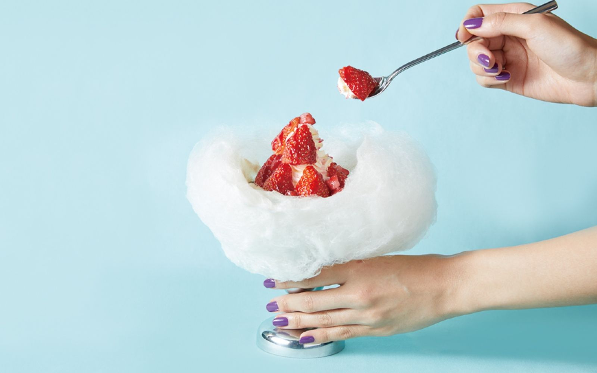

# Desi Drip &mdash; Artisanal Cafe &amp; Specialty Brews ☕🍰



[](https://developer.mozilla.org/en-US/docs/Web/HTML)
[](https://developer.mozilla.org/en-US/docs/Web/CSS)
[](https://getbootstrap.com/)
[](https://fontawesome.com/)
[](https://michalsnik.github.io/aos/)

> **Desi Drip** is a modern, responsive artisanal cafe landing page blending rich South Asian cafe heritage with contemporary specialty slow drips, spiced chai blends, and handcrafted gourmet desserts.

---

## 📖 Table of Contents

- [Overview](#-overview)
- [Website Features](#-website-features)
- [Contact Details &amp; Alternative Channels](#-contact-details--alternative-channels)
- [Technology Stack](#-technology-stack)
- [Project Directory Structure](#-project-directory-structure)
- [Getting Started](#-getting-started)
- [Customization](#-customization)
- [Credits &amp; License](#-credits--license)

---

## 🌟 Overview

**Desi Drip** brings a vibrant, community-focused coffee and tea experience to life on the web. Designed with an inviting palette, modern typography, and smooth micro-animations, the site serves as an interactive hub for customers to explore seasonal specials, browse food and beverage menus, and connect with the cafe through both **primary** and **alternative** channels.

---

## ✨ Website Features

1. **Sticky Navigation Bar (`#navbar`)**:
   - Clean brand identity featuring the custom **Desi Drip** vector emblem.
   - Smooth anchor navigation linking to **Home**, **About**, **Menu Categories**, and **Contact & Visit**.
   - Mobile toggle menu powered by Bootstrap.

2. **Hero Carousel Showcase (`#carouselExampleIndicators`)**:
   - High-resolution carousel with automated transitions showcasing the cozy ambiance, specialty drips, and dessert creations.
   - Custom captions with frosted-glass backdrop styling.

3. **About &amp; Story Section (`#about`)**:
   - Narrative of the **Desi Drip** concept and culinary philosophy.
   - Interactive circular social media links with floating hover effects (Instagram, Twitter, Facebook, WhatsApp).

4. **Explore Our Menu Section (`#menu`)**:
   - Responsive multi-card layout displaying **Seasonal Limited**, **Savory & Food**, and **Desserts & Drips**.
   - Category badges (`Chef's Special`, `Savory`, `Signature`) and direct reserve/download action buttons.
   - Scroll-triggered animations via AOS.

5. **Comprehensive Contact &amp; Visit Section (`#contact`)**:
   - Two-column structured view presenting **Primary Cafe Information** and **Alternative Contact Details**.
   - Direct interactive links: `tel:`, `mailto:`, and instant WhatsApp chat.
   - Embedded interactive **Google Maps** frame with quick directions button.

---

## 📞 Contact Details & Alternative Channels

To ensure seamless customer service and accessibility, Desi Drip provides both primary desk contacts and dedicated alternative communication channels:

| Channel / Service | Primary Details | Alternative Details |
| :--- | :--- | :--- |
| **Phone / Hotline** | `+1 (555) 789-DRIP` (`+1 555-789-3747`) | `+1 (555) 345-DRIP` (WhatsApp Instant Support) |
| **Email Address** | `hello@desidrip.com` (General Inquiries) | `orders@desidrip.com` (Orders & Catering) <br> `events@desidrip.com` (Private Events & Press) |
| **Physical Address** | **Flagship Cafe:**<br>124 Drip Boulevard, Midtown Cultural District,<br>New York, NY 10001 | **Alternative Pickup Hub:**<br>Express Counter &bull; Suite 402,<br>Arts & Market Walk, New York, NY 10012 |
| **Dine-in Hours** | Mon &ndash; Fri: `08:00 AM &ndash; 10:30 PM`<br>Sat &ndash; Sun: `09:00 AM &ndash; 11:30 PM` | **Online Pickup Windows:**<br>Daily: `08:30 AM &ndash; 10:00 PM` |
| **Kitchen Cutoff** | Food: `21:45` &bull; Drinks: `22:15` | Pre-order Catering: 24h Advance Notice |
| **Delivery Partners** | Direct Cafe Counter Takeout | Available on **UberEats**, **DoorDash**, **Grubhub** (`@DesiDrip`) |

---

## 🛠 Technology Stack

- **Core Structure**: [HTML5](https://developer.mozilla.org/en-US/docs/Web/HTML) (Semantic markup, meta tags, accessibility attributes)
- **Styling**: [CSS3](https://developer.mozilla.org/en-US/docs/Web/CSS) (Custom responsive styles, gradient accents, modern flex/grid layouts)
- **UI Framework**: [Bootstrap 4.5.0](https://getbootstrap.com/docs/4.5/getting-started/introduction/)
- **Iconography**: [Font Awesome 4.7.0](https://fontawesome.com/v4.7.0/)
- **Animations**: [AOS - Animate On Scroll Library](https://michalsnik.github.io/aos/)
- **Typography**:
  - `Outfit` (Modern body font)
  - `Tenali Ramakrishna` (Artisanal heading typography)
  - `Josefin Sans` (Subheadings & nav elements)

---

## 📁 Project Directory Structure

```text
Desi-Drip/
│
├── index.html                   # Main landing page for Desi Drip
├── style.css                    # Custom styles, design tokens & responsive rules
├── README.md                    # Project documentation & website guide
│
└── images/                      # Media assets directory
    ├── desi-drip-logo.svg       # Custom vector SVG logo for Desi Drip
    ├── logo.jpg                 # Original logo asset
    ├── main01.jpeg              # Hero carousel slide 1
    ├── main02.jpg               # Hero carousel slide 2
    ├── main03.jpg               # Hero carousel slide 3
    ├── seasonal_limited.jpg     # Seasonal menu card image
    ├── food_bonbon.jpg          # Savory food menu card image
    ├── dessert.jpg              # Desserts & drips menu card image
    └── wired-bonbon-demo.gif    # Demo preview GIF
```

---

## 🚀 Getting Started

### Prerequisites

No build tools or server dependencies required! The project runs natively in all modern web browsers.

### Running Locally

1. **Clone or Navigate to the Repository**:
   ```bash
   git clone https://github.com/clemcodes/wiredbonbon.git Desi-Drip
   cd Desi-Drip
   ```

2. **Open in Browser**:
   - Double-click `index.html` in your file explorer, **or**
   - Run a lightweight development server:
     ```bash
     # Using Python 3
     python -m http.server 8000
     ```
     Then open [http://localhost:8000](http://localhost:8000) in your web browser.

---

## 🎨 Customization

- **Change Brand Name & Logo**:
  - Edit the SVG in `images/desi-drip-logo.svg` or swap the image path in `<a class="navbar-brand">`.
  - Update the `<title>` tag and headings in `index.html`.
- **Update Contact Information**:
  - Modify the primary or alternative telephone, email, and address in the `#contact` section of `index.html`.
- **Adjust Colors & Styling**:
  - Edit color variables, gradients, and fonts directly inside `style.css`.

---

## 📄 Credits & License

- Designed & coded originally by [Clementine Liu](https://www.linkedin.com/in/shuyanliu/).
- Rebranded and updated for **Desi Drip**.
- Licensed under the [MIT License](https://opensource.org/licenses/MIT).
